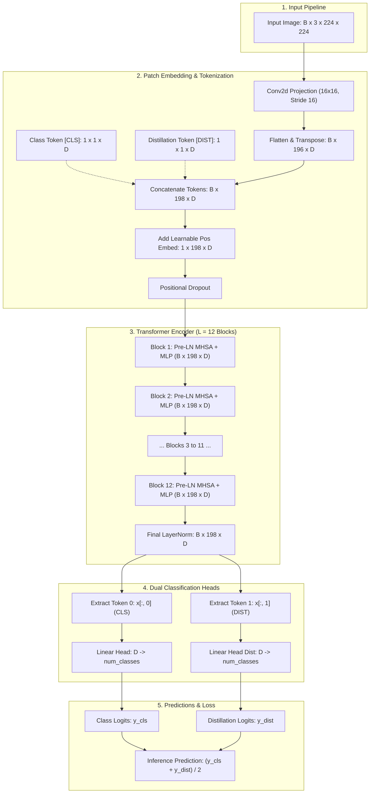
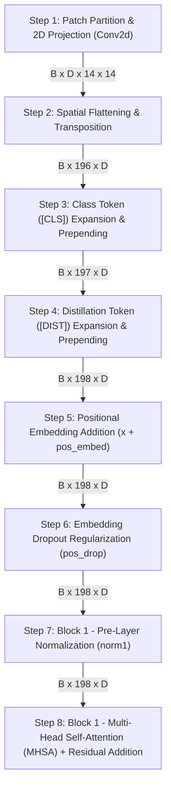
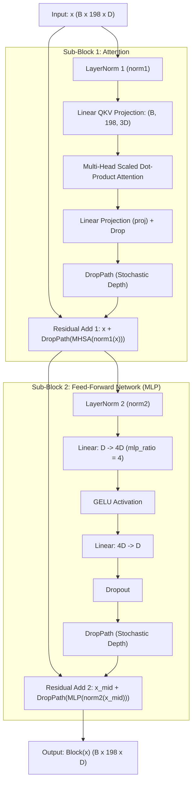
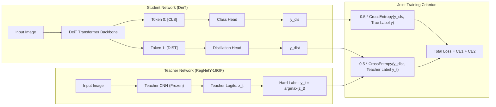

# Architectural Review & Specification: DeiT (Data-efficient Image Transformers)

**Repository Reference**: [facebookresearch/deit](https://github.com/facebookresearch/deit)  
**Paper**: *Training data-efficient image transformers & distillation through attention* (Touvron et al., Meta AI / Sorbonne University, ICML 2021)  
**Document Target**: Deep dive into the architectural mechanics, tensor dimensions, and the sequential execution order, highlighting the **first 8 steps** of the architecture.

---

## 1. Executive Summary & Core Innovations

The Vision Transformer (ViT, Dosovitskiy et al., 2020) demonstrated that pure transformer architectures could match or surpass Convolutional Neural Networks (CNNs) in computer vision. However, original ViTs required massive proprietary pre-training datasets (such as JFT-300M or ImageNet-21k) to reach high accuracy because transformers lack the inductive biases (translation equivariance and locality) inherent to convolutions.

**DeiT (Data-efficient Image Transformer)** resolves this fundamental bottleneck:
1. **100% ImageNet-1k Native Training**: Achieves competitive top-1 accuracy (up to **85.2%**) trained solely on ImageNet-1k without external data.
2. **Distillation Token (`[DIST]`)**: Introduces a dedicated learnable token that interacts with patch tokens and the class token (`[CLS]`) via self-attention, specifically capturing the inductive bias transferred from a teacher model.
3. **Hard-Label Distillation**: Discovers that taking the hard decision of a convolutional teacher (e.g., RegNetY-16GF) strongly outperforms classical soft distillation (KL divergence).
4. **Dual-Head Architecture & Joint Inference**: Employs two classification heads during training (`head` for ground truth and `head_dist` for the teacher's prediction) and averages their softmax predictions at test time.

---

## 2. High-Level Architecture Overview

The following diagram illustrates the complete dataflow of DeiT, from the input image through tokenization, distillation token insertion, transformer encoder layers, and dual output heads.

---

## 3. The First 8 Steps of the DeiT Architecture

Below is the exact chronological sequence of the **first 8 steps** that an input tensor undergoes in DeiT (from raw image input into the forward pass of `DistilledVisionTransformer` and `forward_features`).

### Detailed Breakdown of the First 8 Steps

Assuming standard configuration ($B$ = Batch Size, Image Size $224 \times 224$, Patch Size $P = 16$, Channels $C = 3$, Embedding Dimension $D$):
- **DeiT-Ti**: $D = 192$, Heads = 3
- **DeiT-S**: $D = 384$, Heads = 6
- **DeiT-B**: $D = 768$, Heads = 12

---

### Step 1: Patch Partitioning and Linear Projection (2D Convolution)
* **Code Reference**: `self.patch_embed.proj` (`nn.Conv2d(in_chans=3, out_chans=D, kernel_size=16, stride=16)`)
* **Input Shape**: $\mathbf{X} \in \mathbb{R}^{B \times 3 \times 224 \times 224}$
* **Operation**:
  Rather than slicing patches manually and multiplying with a linear projection matrix, DeiT implements patch extraction and projection simultaneously using a 2D convolution with non-overlapping kernel and stride:
  $$\mathbf{X}_{proj} = \text{Conv2D}(\mathbf{X}, \text{weight} \in \mathbb{R}^{D \times 3 \times 16 \times 16}, \text{stride}=16)$$
* **Output Shape**: $\mathbf{X}_{proj} \in \mathbb{R}^{B \times D \times 14 \times 14}$ (since $224 / 16 = 14$).

---

### Step 2: Patch Flattening and Sequence Transposition
* **Code Reference**: `x.flatten(2).transpose(1, 2)` inside `PatchEmbed.forward()`
* **Input Shape**: $\mathbb{R}^{B \times D \times 14 \times 14}$
* **Operation**:
  1. The 2D spatial grid $(14 \times 14)$ is flattened into a 1D sequence of length $N = 14 \times 14 = 196$ patches:
     $$\mathbb{R}^{B \times D \times 14 \times 14} \xrightarrow{\text{flatten}(2)} \mathbb{R}^{B \times D \times 196}$$
  2. The tensor is transposed to bring the sequence dimension before the feature dimension:
     $$\mathbb{R}^{B \times D \times 196} \xrightarrow{\text{transpose}(1, 2)} \mathbb{R}^{B \times 196 \times D}$$
  3. Optional patch normalization `norm(x)` is applied (if configured; defaults to identity in baseline ViT/DeiT).
* **Output Shape**: $\mathbf{X}_{seq} \in \mathbb{R}^{B \times 196 \times D}$.

---

### Step 3: Class Token (`[CLS]`) Expansion & Prepending
* **Code Reference**: `cls_tokens = self.cls_token.expand(B, -1, -1)`
* **Input Shapes**:
  - Patch Sequence: $\mathbf{X}_{seq} \in \mathbb{R}^{B \times 196 \times D}$
  - Parameter: `self.cls_token` $\in \mathbb{R}^{1 \times 1 \times D}$ (initialized with truncated normal $\sigma=0.02$)
* **Operation**:
  The learnable `[CLS]` token is replicated across the batch dimension using `expand(B, -1, -1)` to form a tensor of shape $[B, 1, D]$, and concatenated at the beginning of the sequence:
  $$\mathbf{X}_{cls\_cat} = [\mathbf{T}_{cls}; \mathbf{X}_{seq}]$$
* **Output Shape**: $\mathbb{R}^{B \times 197 \times D}$ (1 Class token + 196 Patch tokens).

---

### Step 4: Distillation Token (`[DIST]`) Expansion & Prepending (DeiT Core Signature)
* **Code Reference**: `dist_token = self.dist_token.expand(B, -1, -1); x = torch.cat((cls_tokens, dist_token, x), dim=1)`
* **Input Shapes**:
  - Class token + Patches: $\mathbf{X}_{cls\_cat} \in \mathbb{R}^{B \times 197 \times D}$
  - Parameter: `self.dist_token` $\in \mathbb{R}^{1 \times 1 \times D}$
* **Operation**:
  DeiT's distinctive architectural component. A separate learnable distillation token is expanded across batch size $B$ and inserted immediately adjacent to the `[CLS]` token:
  $$\mathbf{X}_{tokens} = \text{Concat}([\mathbf{T}_{cls}, \mathbf{T}_{dist}, \mathbf{X}_{seq}], \text{dim}=1)$$
  *Index assignment:*
  - Index `0`: `[CLS]` token (trained to predict true class labels)
  - Index `1`: `[DIST]` token (trained to mimic the teacher CNN's hard predictions)
  - Indices `2..197`: 196 image patch tokens
* **Output Shape**: $\mathbf{X}_{tokens} \in \mathbb{R}^{B \times 198 \times D}$ ($N + 2$ tokens).

---

### Step 5: Positional Embedding Addition ($x + \mathbf{E}_{pos}$)
* **Code Reference**: `x = x + self.pos_embed`
* **Input Shapes**:
  - Token sequence: $\mathbf{X}_{tokens} \in \mathbb{R}^{B \times 198 \times D}$
  - Parameter: `self.pos_embed` $\in \mathbb{R}^{1 \times 198 \times D}$
* **Operation**:
  Because standard multi-head self-attention is permutation-invariant, spatial structure must be explicitly injected. DeiT learns a 1D position embedding matrix of size $(1, N+2, D) = (1, 198, D)$ and adds it element-wise:
  $$\mathbf{X}_{pos} = \mathbf{X}_{tokens} + \mathbf{E}_{pos}$$
  Both the prefix tokens (`[CLS]` and `[DIST]`) and all 196 patch tokens receive unique spatial/functional identity vectors.
* **Output Shape**: $\mathbf{X}_{pos} \in \mathbb{R}^{B \times 198 \times D}$.

---

### Step 6: Positional Dropout Regularization (`pos_drop`)
* **Code Reference**: `x = self.pos_drop(x)`
* **Input Shape**: $\mathbf{X}_{pos} \in \mathbb{R}^{B \times 198 \times D}$
* **Operation**:
  Applies standard dropout across the position-embedded sequence:
  $$\mathbf{X}_{0} = \text{Dropout}(\mathbf{X}_{pos}, p = \text{drop\_rate})$$
  *(In standard DeiT training, `drop_rate` is typically set to 0.0, but the dropout module is evaluated as the gateway into the Transformer blocks).*
* **Output Shape**: $\mathbf{X}_{0} \in \mathbb{R}^{B \times 198 \times D}$.

---

### Step 7: Block 1 Pre-Layer Normalization 1 (`norm1`)
* **Code Reference**: `self.blocks[0].norm1(x)` (`nn.LayerNorm(D, eps=1e-6)`)
* **Input Shape**: $\mathbf{X}_{0} \in \mathbb{R}^{B \times 198 \times D}$
* **Operation**:
  DeiT adopts the **Pre-LN** Transformer formulation (LayerNorm applied *before* the Multi-Head Attention, rather than Post-LN as in original Vaswani et al.). LayerNorm is computed independently for each token over the last dimension $D$:
  $$\mathbf{X}_{norm1} = \text{LayerNorm}(\mathbf{X}_{0}) = \frac{\mathbf{X}_{0} - \mu}{\sqrt{\sigma^2 + \epsilon}} \odot \gamma + \beta$$
* **Output Shape**: $\mathbf{X}_{norm1} \in \mathbb{R}^{B \times 198 \times D}$.

---

### Step 8: Block 1 Multi-Head Self-Attention (MHSA) & Residual Connection
* **Code Reference**: `x = x + self.drop_path(self.attn(self.norm1(x)))`
* **Input Shape**: Normalized tensor $\mathbf{X}_{norm1} \in \mathbb{R}^{B \times 198 \times D}$ and residual input $\mathbf{X}_{0} \in \mathbb{R}^{B \times 198 \times D}$
* **Operation**:
  1. **Linear QKV Projection**:
     $$\mathbf{QKV} = \mathbf{X}_{norm1} \mathbf{W}_{qkv} \in \mathbb{R}^{B \times 198 \times 3D}$$
     Split into Queries, Keys, and Values for $h$ attention heads ($d_k = D / h$):
     $$\mathbf{Q}, \mathbf{K}, \mathbf{V} \in \mathbb{R}^{B \times h \times 198 \times d_k}$$
  2. **Scaled Dot-Product Attention**:
     $$\mathbf{A} = \text{Softmax}\left(\frac{\mathbf{Q} \mathbf{K}^T}{\sqrt{d_k}}\right) \in \mathbb{R}^{B \times h \times 198 \times 198}$$
  3. **Value Aggregation & Linear Projection**:
     $$\text{HeadOut} = (\mathbf{A} \mathbf{V}) \in \mathbb{R}^{B \times 198 \times D}$$
     $$\mathbf{X}_{attn} = \text{HeadOut} \mathbf{W}_{proj} \in \mathbb{R}^{B \times 198 \times D}$$
  4. **Stochastic Depth (`drop_path`) and First Residual Skip Connection**:
     $$\mathbf{X}_{mid} = \mathbf{X}_{0} + \text{DropPath}(\mathbf{X}_{attn})$$
* **Output Shape**: $\mathbf{X}_{mid} \in \mathbb{R}^{B \times 198 \times D}$.

---

## 4. Internal Architecture of a DeiT Transformer Block

Every Transformer block in DeiT repeats the Pre-LN structure with stochastic depth (`DropPath`):

---

## 5. Distillation Mechanism: The Teacher-Student Interaction

DeiT introduces distillation through attention. A convolutional teacher network (specifically `RegNetY-16GF`, 84M params) generates targets for the student DeiT.

### Hard Distillation Loss Formulation
The objective function utilized in `losses.py`:
$$\mathcal{L}_{\text{global}}^{\text{hard}} = \frac{1}{2} \mathcal{L}_{\text{CE}}(\psi(x), y) + \frac{1}{2} \mathcal{L}_{\text{CE}}(\psi_{\text{dist}}(x), y_t)$$
Where:
- $\psi(x)$ is the output of the class head (`self.head(x[:, 0])`).
- $\psi_{\text{dist}}(x)$ is the output of the distillation head (`self.head_dist(x[:, 1])`).
- $y$ is the ground-truth one-hot/label-smoothed target.
- $y_t = \arg\max Z_t(x)$ is the hard decision predicted by the teacher CNN.

### Inference Mode
During test time, no teacher is required. The model combines both heads:
$$\hat{y} = \frac{\psi(x) + \psi_{\text{dist}}(x)}{2}$$
This ensemble of two complementary views (ground truth label objective + CNN inductive bias) consistently improves top-1 ImageNet accuracy by **1.0% to 2.5%** across all scales.

---

## 6. DeiT Model Configurations & Specifications

| Model Name | Patch Size | Embed Dim ($D$) | Depth ($L$) | Heads ($h$) | Head Dim ($d_k$) | Parameters | FLOPs (224) | ImageNet Top-1 |
| :--- | :---: | :---: | :---: | :---: | :---: | :---: | :---: | :---: |
| **DeiT-Ti** | $16 \times 16$ | 192 | 12 | 3 | 64 | 5.7M | 1.3G | 72.2% |
| **DeiT-Ti Distilled** | $16 \times 16$ | 192 | 12 | 3 | 64 | 5.9M | 1.3G | **74.5%** |
| **DeiT-S** | $16 \times 16$ | 384 | 12 | 6 | 64 | 22.1M | 4.6G | 79.9% |
| **DeiT-S Distilled** | $16 \times 16$ | 384 | 12 | 6 | 64 | 22.4M | 4.6G | **81.2%** |
| **DeiT-B** | $16 \times 16$ | 768 | 12 | 12 | 64 | 86.6M | 17.6G | 81.8% |
| **DeiT-B Distilled** | $16 \times 16$ | 768 | 12 | 12 | 64 | 87.3M | 17.6G | **83.4%** |
| **DeiT-B 384** | $16 \times 16$ | 768 | 12 | 12 | 64 | 86.9M | 55.5G | 83.1% |
| **DeiT-B Distilled 384** | $16 \times 16$ | 768 | 12 | 12 | 64 | 87.7M | 55.6G | **85.2%** |

---

## 7. Comparison: Standard ViT vs. DeiT

| Feature | Original ViT (Dosovitskiy et al.) | DeiT (Touvron et al.) |
| :--- | :--- | :--- |
| **Training Data Requirement** | Requires JFT-300M or ImageNet-21k | Trains purely on standard ImageNet-1k |
| **Sequence Tokens** | $1 + N$ (1 `[CLS]` + $N$ Patches) | $2 + N$ (1 `[CLS]` + 1 `[DIST]` + $N$ Patches) |
| **Inductive Bias Source** | Weak (requires massive dataset) | Injected via CNN Teacher distillation |
| **Distillation Mechanism** | None | Hard distillation token via cross-attention |
| **Classification Heads** | Single linear head on `[CLS]` | Dual heads (`head` and `head_dist`) averaged at test time |
| **Training Recipes** | Standard Adam / simple augmentation | RandAugment, Mixup, CutMix, Random Erasing, Repeated Aug |

---

## 8. Summary Table of the First 8 Operational Steps

| Step # | Operation Name | Module / PyTorch Function | Tensor Input Shape | Tensor Output Shape | Purpose & Mechanics |
| :---: | :--- | :--- | :---: | :---: | :--- |
| **1** | Patch Embedding Projection | `patch_embed.proj` (`nn.Conv2d`) | $[B, 3, 224, 224]$ | $[B, D, 14, 14]$ | Decomposes 2D image into non-overlapping $16 \times 16$ patches and projects to embedding space $D$. |
| **2** | Flatten & Transposition | `.flatten(2).transpose(1, 2)` | $[B, D, 14, 14]$ | $[B, 196, D]$ | Converts spatial 2D feature map to a 1D sequence of length $N=196$ tokens. |
| **3** | Class Token Prepending | `cls_token.expand()` + `torch.cat` | $[B, 196, D]$ | $[B, 197, D]$ | Appends learnable `[CLS]` token to aggregate holistic context for ground-truth class prediction. |
| **4** | Distillation Token Prepending | `dist_token.expand()` + `torch.cat` | $[B, 197, D]$ | $[B, 198, D]$ | Appends learnable `[DIST]` token to capture CNN teacher inductive biases. |
| **5** | Positional Embedding Addition | `x = x + self.pos_embed` | $[B, 198, D]$ | $[B, 198, D]$ | Injects 1D spatial and functional coordinates into permutation-invariant self-attention. |
| **6** | Positional Dropout | `self.pos_drop(x)` | $[B, 198, D]$ | $[B, 198, D]$ | Regularizes embeddings against co-adaptation before entering encoder blocks. |
| **7** | Block 1 Pre-LayerNorm | `blocks[0].norm1(x)` | $[B, 198, D]$ | $[B, 198, D]$ | Normalizes token features across dimension $D$ (Pre-LN) for training gradient stability. |
| **8** | Block 1 MHSA + Skip 1 | `x + DropPath(MHSA(norm1(x)))` | $[B, 198, D]$ | $[B, 198, D]$ | Computes multi-head scaled dot-product attention across all 198 tokens and adds residual skip. |
