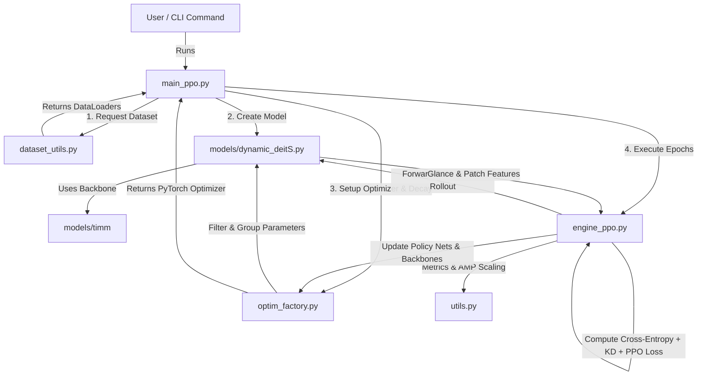

# Codebase Analysis & Architecture Report: AdaptiveNN (DLfCV)

## Executive Summary

**AdaptiveNN_DLfCV** is a PyTorch-based Deep Learning codebase designed for **dynamic image classification** using Vision Transformers (specifically DeiT - Data-efficient Image Transformers) guided by **Proximal Policy Optimization (PPO)**.

Instead of processing an entire high-resolution image through a heavy Vision Transformer, AdaptiveNN breaks inference into sequential stages:
1. **Glance Stage:** A lightweight network extracts initial global coarse features at a smaller resolution (`glance_input_size`).
2. **Focus/Policy Stage (Reinforcement Learning via PPO):** A policy network selects informative image sub-regions (patches) sequentially based on spatial attention.
3. **Classification & Refinement:** The high-resolution local crops are processed via a focus network, accumulating state features and distillation loss to optimize speed versus classification accuracy.

---

## Workspace Structure & Component Mapping

Below is the directory map of the codebase:

```
AdaptiveNN_DLfCV/
├── _artifacts/                  # Target directory for reports & experiment artifacts
├── assets/                      # Visual assets / documentation images
├── models/
│   ├── dynamic_deitS.py         # Primary Architecture: Dynamic DeiT-Small & Policy Networks
│   └── timm/                    # Local copy/extension of PyTorch Image Models library
├── dataset_utils.py             # Data loading, augmentations & dataset builders
├── engine_ppo.py                # Core training & evaluation loops with PPO updates & Distillation
├── main_ppo.py                  # Main entry point: CLI arguments, distributed setup, execution pipeline
├── optim_factory.py             # Custom parameter grouping, layer-wise decay, optimizer creation
├── utils.py                     # Distributed training, metric tracking, checkpoints & logging utilities
├── GET_STARTED.md               # Quickstart setup, training & evaluation instructions
└── requirements.txt             # Dependency specification (torch, torchvision, timm, tensorboardX, etc.)
```

---

## In-Depth File-by-File Breakdown

### 1. [`main_ppo.py`](file:///f:/PERSONALES/_PROJECTS/AdaptiveNN_DLfCV/main_ppo.py) — Application Entry Point
- **Purpose:** Manages CLI parsing, distributed node initialization, dataset loading, model instantiations, optimizer creation, and execution of epoch loops.
- **Key Functionalities:**
  - `get_args_parser()`: Defines extensive hyperparameters (batch size, learning rate, PPO settings like `--ppo_lam`, `--gamma`, glance/focus sizes).
  - Initializes distributed data parallel execution (`torch.distributed`).
  - Builds train/eval datasets via [`dataset_utils.py`](file:///f:/PERSONALES/_PROJECTS/AdaptiveNN_DLfCV/dataset_utils.py).
  - Instantiates `dynamic_deitS` using `timm.models.create_model`.
  - Configures layer-wise learning rate decay and parameter groups using [`optim_factory.py`](file:///f:/PERSONALES/_PROJECTS/AdaptiveNN_DLfCV/optim_factory.py).
  - Invokes `train_one_epoch()` and `evaluate()` from [`engine_ppo.py`](file:///f:/PERSONALES/_PROJECTS/AdaptiveNN_DLfCV/engine_ppo.py).

### 2. [`models/dynamic_deitS.py`](file:///f:/PERSONALES/_PROJECTS/AdaptiveNN_DLfCV/models/dynamic_deitS.py) — Neural Network Architecture & Policy Network
- **Purpose:** Defines the dual-network adaptive architecture (`dynamic_deitS`) and patch selection policy head (`policy_net_patch`).
- **Key Components:**
  - `policy_net_patch`: Lightweight CNN + Linear head that takes feature maps and outputs policy spatial sampling actions (2D coordinates) or state-value estimations ($V(s)$).
  - `dynamic_deitS`:
    - `glance_net`: DeiT backbone processing coarse global images.
    - `focus_net`: DeiT backbone processing selected high-resolution cropped patches.
    - `forward_backbone()`: Executes glance-to-focus inference sequence across `seq_l` steps.
    - `evaluate_policy_net()`: Evaluates stored state features during PPO policy optimization steps.

### 3. [`engine_ppo.py`](file:///f:/PERSONALES/_PROJECTS/AdaptiveNN_DLfCV/engine_ppo.py) — PPO Training Engine & Knowledge Distillation
- **Purpose:** Handles the forward pass, multi-component loss evaluation, loss backward scaling, and PPO policy parameter updates.
- **Key Mechanics:**
  - **Loss Function composition:**
    $$\text{Loss} = \lambda_{\text{reg}} \mathcal{L}_{\text{reg\_focus}} + \mathcal{L}_{\text{focus}} + \mathcal{L}_{\text{glance}} + \alpha_{\text{KD}} \mathcal{L}_{\text{KD}}$$
  - **Knowledge Distillation ($\mathcal{L}_{\text{KD}}$):** Aligns predictions from `glance_net` and intermediate focus steps with the final teacher output (`x_focus[-1]`).
  - **PPO Trajectory Updates:** Collects policy actions, log-probabilities, and advantage estimates ($A_t$), running PPO policy clipping updates every `update_policy_freq` iterations.
  - **Evaluation (`evaluate`):** Calculates Top-1 and Top-5 accuracy across test sets.

### 4. [`dataset_utils.py`](file:///f:/PERSONALES/_PROJECTS/AdaptiveNN_DLfCV/dataset_utils.py) — Dataset Pipelines & Data Augmentations
- **Purpose:** Builds torchvision datasets and `timm` data transforms.
- **Key Functions:**
  - `build_dataset()`: Supports `CIFAR100`, `ImageNet-1K` (`IMNET`), and custom `image_folder` directory layouts.
  - `build_transform()`: Applies AutoAugment, Color Jitter, Random Erasing, and resolution resizing/warping depending on `input_size`.

### 5. [`optim_factory.py`](file:///f:/PERSONALES/_PROJECTS/AdaptiveNN_DLfCV/optim_factory.py) — Optimizer Factory & Layer-Decay Assigners
- **Purpose:** Custom parameter group router for ViT models and policy parameters.
- **Key Features:**
  - `get_parameter_groups()`: Segregates parameters into decaying vs. non-decaying (bias, LayerNorm) groups. Applies special learning rate multipliers (`stn_lr_ratio`, `bone_lr_scale`) to policy network weights.
  - `create_optimizer()`: Supports `AdamW`, `SGD`, `Nadam`, `Adafactor`, `Adahessian`, and Apex fused optimizers.

### 6. [`utils.py`](file:///f:/PERSONALES/_PROJECTS/AdaptiveNN_DLfCV/utils.py) — System Utilities & Distributed Helpers
- **Purpose:** Infrastructure utilities supporting training execution.
- **Key Elements:**
  - `MetricLogger` & `SmoothedValue`: Tracks smooth exponential moving averages of metrics (loss, accuracy, LR, PPO std deviation).
  - `NativeScalerWithGradNormCount`: Automatic Mixed Precision (AMP) gradient scaling with gradient clipping.
  - Distributed helper functions (`init_distributed_mode`, `is_main_process`, IPC synchronization).
  - Model checkpoint saving and resuming (`save_model`).

---

## Inter-File Linking & System Flow Diagram



---

## Key Design Patterns & Reinforcement Learning Integration

1. **Policy Gradient via PPO:**
   The action space consists of continuous patch crop coordinates $[x, y]$ within the input image space. The policy network (`policy_net_patch`) outputs mean and standard deviation vectors to sample locations, while `engine_ppo.py` optimizes this policy via standard PPO clipped surrogate objective and Generalized Advantage Estimation (GAE).
2. **Dual-Backbone Feature Reuse:**
   `glance_net` quickly processes downsampled inputs to provide a global feature map. `focus_net` takes targeted high-resolution crops guided by the policy network, allowing the model to make dynamic predictions with reduced overall floating-point operations (FLOPs).
3. **Teacher-Student Knowledge Distillation:**
   Intermediate classification outputs from earlier time-steps (`x_focus[i]` and `x_glance`) are constrained to match the logit probability distribution of the final focus step (`x_focus[-1]`) via KL-Divergence loss.
